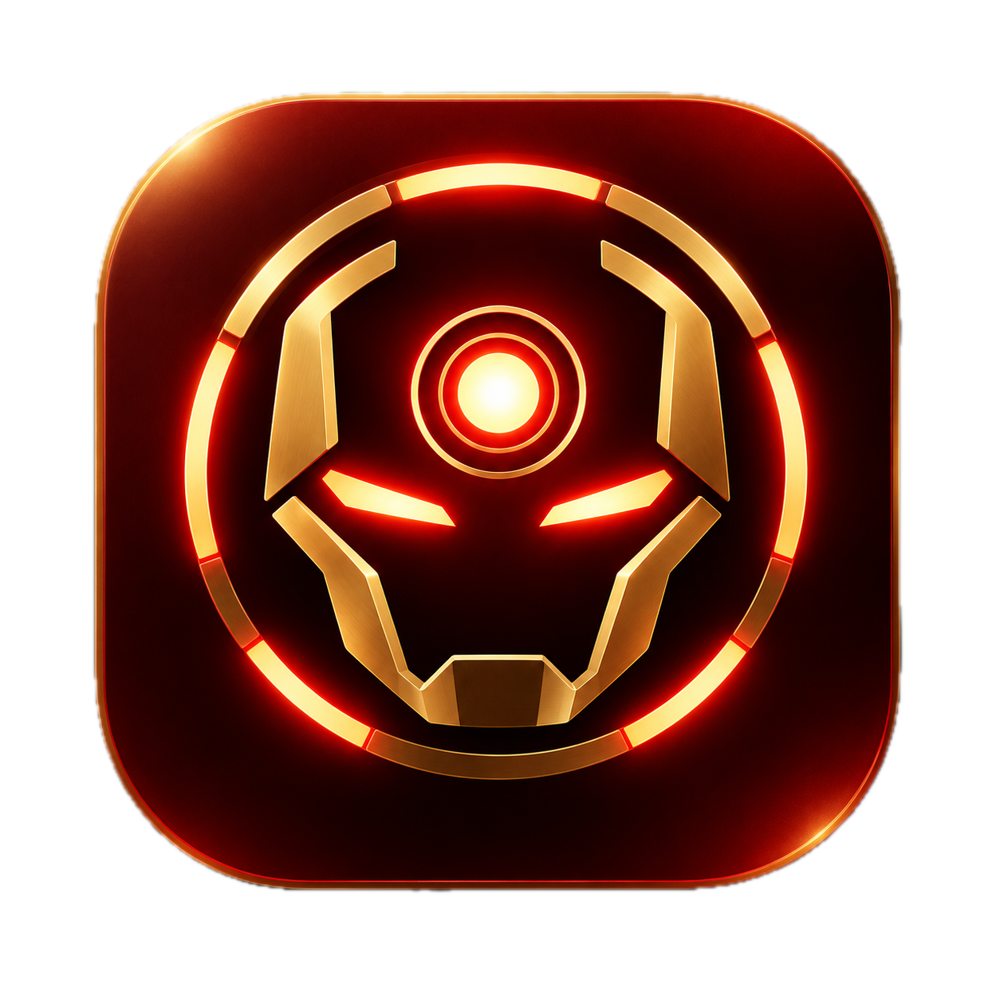
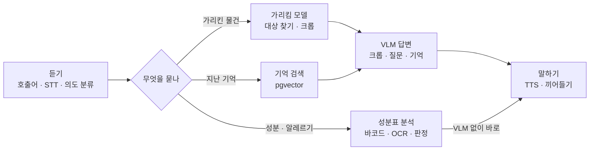
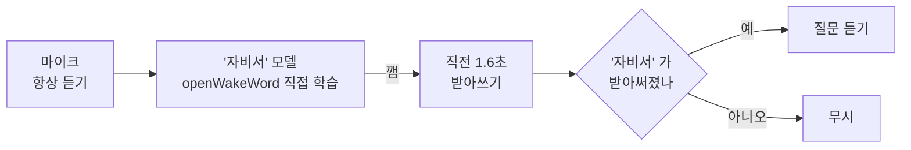
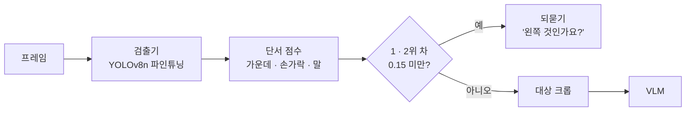
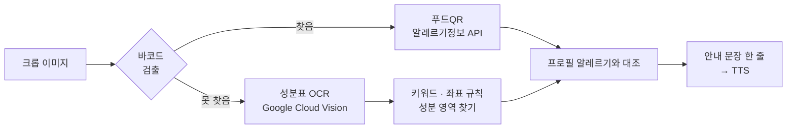
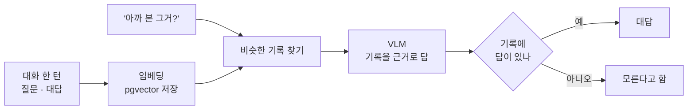
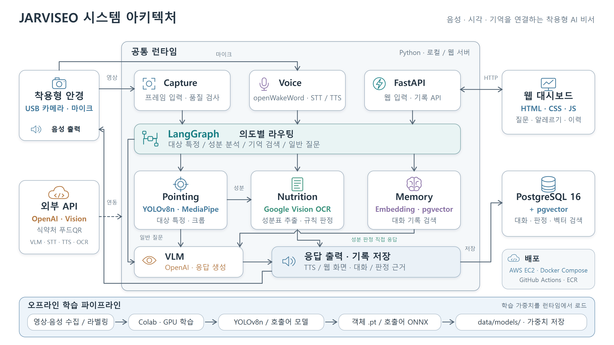
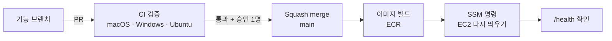

# 🕶️ 무크 인더스트리

### 자비서 (JARVISEO)

**당신의 시야에 AI 를 더하다 — 웨어러블 AI 안경 비서**

2026.09.21 ~ 2026.11.03

---

## 🚀 왜 만들었나

궁금한 건 눈앞에 있는데, 답은 휴대폰 속에 있습니다.

- **휴대폰을 꺼내고** — 손에 든 걸 내려놓아야 한다
- **검색어를 떠올리고** — 처음 보는 물건은 이름부터 모른다
- **결과를 읽어 내려간다** — 화면을 계속 보고 있어야 한다

다른 일을 하고 있을 때, 먹기 직전일 때 이 세 단계는 꽤 멉니다.
처음 보는 과자를 집었을 때 *"내 알레르기 성분이 들어 있을까?"* 같은 질문이 그렇습니다.

그래서 **안경테에 초소형 카메라를 붙였습니다.**
"자비서, 이거 뭐야?" 하고 부르면 **보고, 묻고, 듣는** 세 단계로 끝납니다.

---

## ✨ 주요 기능

<table>
<tr>
<td width="50%" valign="top">

### 🗣️ 호출어 "자비서"
저희 목소리로 **직접 학습한** 호출어 모델이 항상 듣고 있습니다.
깨어나면 받아쓰기로 한 번 더 확인해서 TV 소리에 잘못 깨지 않습니다.

### 👉 "이거 뭐야?"
손가락 방향 · 질문 속 말 · 화면 위치를 단서로 **가리킨 물건을 고릅니다.**
애매하면 "왼쪽 것인가요?" 하고 **되묻습니다.**

### 🥫 성분표 알레르기 확인
**바코드를 먼저 찾고, 없으면 성분표를 읽습니다.**
내 알레르기와 대조한 결과를 5초 안에 음성으로 알려 줍니다.

</td>
<td width="50%" valign="top">

### 🧠 "아까 본 그거 뭐였지?"
질문과 대답을 기록해 두고, 지난 대화에서 **근거를 찾아 답합니다.**
기록에 없으면 지어내지 않고 모른다고 합니다.

### ⚡ 대화처럼 빠르게
"잠깐만요" 를 말하는 동안 대답을 미리 만들고,
읽는 도중에 다시 부르면 **바로 멈추고** 새 질문을 받습니다.

### 📊 웹 대시보드
턴마다 질문 · 대답 · 판정 결과를 웹에서 봅니다.

</td>
</tr>
</table>

---

## 🧠 AI 파이프라인

질문 하나가 **LangGraph 그래프** 하나를 지나갑니다.

**성분 판정은 VLM 을 거치지 않습니다.** 정해진 문장으로 바로 음성에 넘겨서 빠르고, 지어내지 않습니다.

 

### 🗣️ 호출어 — 직접 학습 + 한 번 더 확인

"자비서" 전용 기성 모델은 없습니다. 발음이 가장 비슷한 `hey_jarvis` 는 **한 번도 알아듣지 못했습니다.**
그래서 저희 목소리와 합성 음성으로 **6번 학습**했습니다.

| | 기성 hey_jarvis | 직접 학습한 '자비서' |
| --- | :---: | :---: |
| 조용할 때 놓침 | 100% | **5.6%** |
| 소음 속 놓침 | 100% | **12.5%** |
| 비슷한 발음에 잘못 깸 | — | **5%** |

임계값을 올리면 잘못 깨는 횟수는 줄지만 소음 속에서 40% 를 놓칩니다.
그래서 임계값 대신 **깨어난 직전 1.6초를 받아써 한 번 더 확인**했습니다.
유튜브 30분에 3번 잘못 깨던 것이 **약 2시간 동안 0번**이 됐습니다.

 

### 👉 가리킴 — 단서를 하나씩 쌓기

물건마다 단서 점수를 더해 1위를 고릅니다. **단서를 하나씩 켜고 끄며** 효과를 따로 쟀고,
켜서 손해인 단서(시선)는 꺼 두었습니다. 켜는 기준은 결과를 보기 전에 정했습니다.

가장 큰 문제는 검출기였습니다. 기본 YOLO 는 정답 물건을 후보로 잡는 비율이 50% 에 그쳤고,
**후보에 없는 물건은 어떤 단서로도 고를 수 없습니다.** 안경 카메라 영상으로 자주 쓰는 물건 10종을 파인튜닝했습니다.

| 회차 | 바꾼 것 | 후보 재현율 |
| --- | --- | :---: |
| 기본 | 사전학습 YOLOv8n | 50.0% |
| R1 | 큰 모델이 단 자동 라벨 그대로 | 37.1% |
| **R2** | **같은 사진, 라벨을 직접 검수** | **61.3%** |
| R3 | 새 장면 198장 추가 | 53.2% |

**개발 중 한 번도 열지 않은 시험 사진 40장**에서 대상 정답률 **47.5%** (처음 방식 30%)입니다.

 

### 🥫 성분표 — 바코드 먼저, 안 되면 성분표

바코드로 찾으면 OCR 없이 끝납니다. 판정은 **함유 · 혼입 가능 · 미검출 · 확인 불가** 네 가지입니다.
못 찾은 것과 없는 것은 다르기 때문에 **'안전' 판정은 일부러 두지 않았습니다.**

글자 정확도보다 **알레르기 성분을 놓치지 않는 것**을 기준으로 OCR 엔진을 골랐습니다.

| 단계 | 알레르기 성분 찾은 비율 |
| --- | :---: |
| EasyOCR | 9% |
| PaddleOCR | 55% |
| 파서 버그 3개 수정 | 75% |
| **Google Cloud Vision (최종)** | **95.7%** (139개 중 133개) |

21장 중 18장은 하나도 놓치지 않았고, 평균 처리 시간은 **3.3초**로 목표 5초 안에 들어왔습니다.

 

### 🧠 기억 검색 — 근거가 없으면 모른다고

모든 질문에 답하는 것보다, **기록을 근거로 답하고 모르는 건 모른다고 하는 데** 중점을 뒀습니다.

| 지어낸 대답 | 근거로 답하거나 모른다고 함 | 답이 있는 질문 정답 |
| :---: | :---: | :---: |
| **0 / 30** | **30 / 30** | **13 / 15** |

---

## 🛠 기술 스택

**Backend · 흐름**

**AI**

**DB · Web**

**Infra**

---

## 🏗 아키텍처

  

안경의 USB 카메라 · 마이크 입력을 **공통 런타임** 하나가 받습니다. 같은 Python 코드가 노트북(로컬)에서도, 웹 서버에서도 돕니다.
LangGraph 가 질문을 **대상 특정 · 성분 분석 · 기억 검색 · 일반 질문**으로 나눠 보내고,
성분 판정은 VLM 을 거치지 않고 바로 응답으로 나갑니다.

답변 · 받아쓰기 · 음성 합성은 OpenAI, 성분표 글자는 Google Cloud Vision, 바코드 조회는 식약처 푸드QR API 를 부릅니다.

대화 · 판정 기록과 기억 임베딩은 **PostgreSQL 하나에** 둡니다.
pgvector 는 Postgres 의 확장이라 DB 를 하나 더 띄우지 않고, 임베딩을 그 기록과 같은 행에 둡니다.

학습한 모델(호출어 · 검출기)은 **GitHub Releases** 로 배포하고, 받을 때 SHA256 으로 확인합니다.

---

## 🔄 CI / CD

`main` 에 머지되면 팀 웹이 AWS EC2(서울)에 새 버전으로 올라갑니다.

맥 1대 · 윈도우 2대로 개발해서 **CI 를 세 OS 에서 모두** 돌립니다.
린트 · 포맷 · 테스트에 더해, 실제 Postgres 컨테이너를 띄운 DB 테스트도 따로 돕니다.

배포는 **AWS 키를 GitHub 에 넣지 않습니다.** GitHub OIDC 토큰으로 역할을 빌리고,
SSH 대신 SSM 으로 서버에 명령을 보냅니다.

---

## 👥 팀원

| | 이름 | GitHub | 담당 |
| :---: | :---: | :---: | --- |
| 👑 | **최홍묵** | [@LeoChoi224](https://github.com/LeoChoi224) | 가리킴 모델 · 검출기 파인튜닝 · LangGraph 전체 흐름 연결 · 협업 규칙 · CI · DB 스키마 |
| | **문태현** | [@Moontaehyeon01](https://github.com/Moontaehyeon01) | 호출어 '자비서' 직접 학습 · STT · TTS · 끼어들기 · 기억 검색 · AWS 배포 |
| | **권용현** | [@Kweonyh0](https://github.com/Kweonyh0) | 성분표 분석 (바코드 · OCR · 판정) · 웹 대시보드 · 웹 API · OCR 평가 세트 · 엔진 비교 |

---

Korea IT Academy · LangChain을 활용한 AI 영상객체탐지분석 플랫폼 구축 과정 최종 프로젝트

